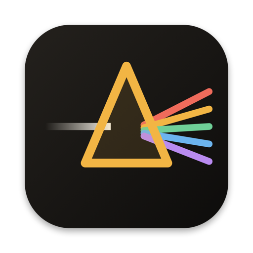
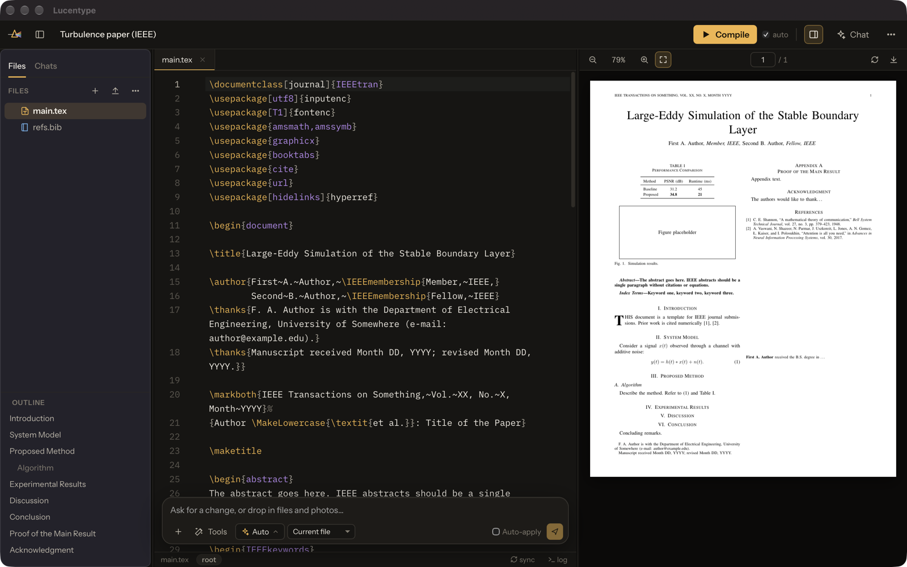
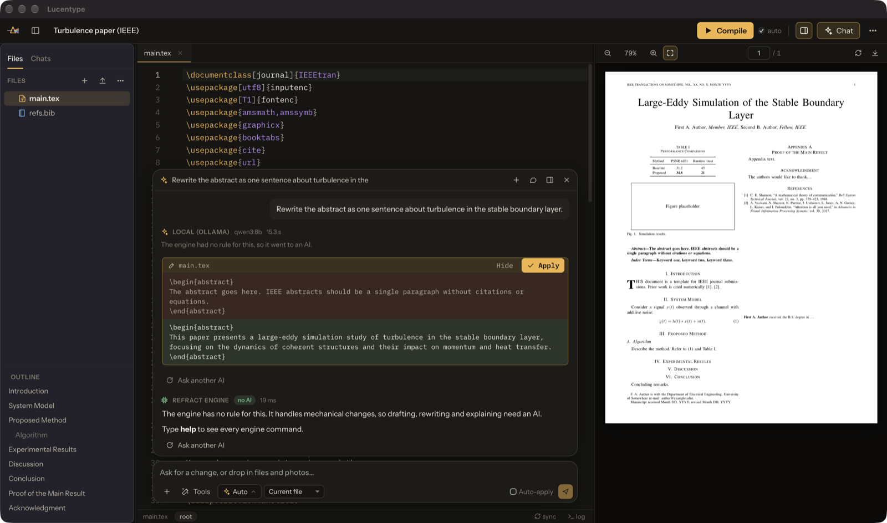
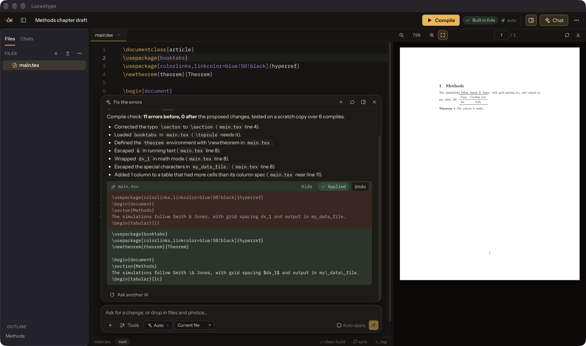
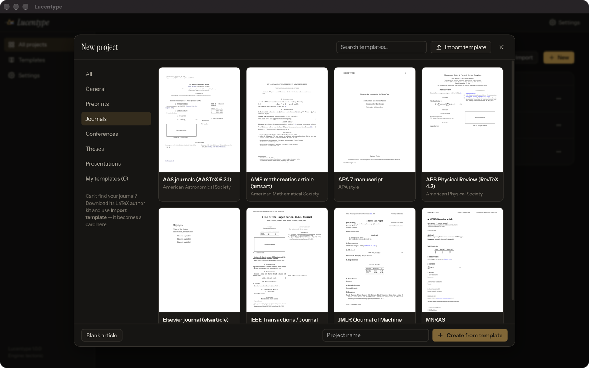

# Lucentype

A LaTeX editor for your Mac with an AI chat that edits your document, and a built-in engine that needs no AI at all.

**[Download Lucentype for Mac](https://github.com/perseus-sepahi/lucentype-app/releases/latest/download/Lucentype.dmg)** ·
[All releases](https://github.com/perseus-sepahi/lucentype-app/releases) ·
[Website](https://perseus-sepahi.github.io/software/lucentype/)

## What it does

- **Write LaTeX with the PDF beside you.** A code editor with LaTeX autocomplete for commands, `\cite` keys from your `.bib` files and `\ref` labels. The PDF rebuilds a moment after you stop typing, and SyncTeX jumps between a line and its place in the PDF. Compile errors link to their lines.
- **Ask for changes in plain words.** A chat box over the editor takes requests like “add a Discussion section after Results” or “turn this into a table”. Each change shows as a card you can apply or undo.
- **Choose who answers.** Claude, ChatGPT, a free open-source model on your own Mac through Ollama, or hosted open models from OpenRouter, Groq, Together AI and others. You can switch per message, or ask another model the same thing and compare.
- **Much of the work needs no AI.** Lucentype's own engine fixes common compile errors and checks each fix with a real compile. It also builds tables from CSV files, adds, renames and moves sections, adds references by DOI, sorts and cleans bibliographies, counts words and checks labels and citations. It works instantly and offline. Type `help` in the chat for the full list.
- **Overleaf projects and journal templates.** Import an Overleaf `.zip` export and export back the same way. 16 templates are included: IEEE, ACM, Elsevier, APS RevTeX, AMS, Springer LNCS, JMLR, AAS, MNRAS, APA 7, arXiv, a multi-chapter thesis, Beamer slides and more. You can also add your journal's own author kit as a template.
- **Attach files and photos** to a chat message: images, PDFs, CSV and other text files.

| Chat | No-AI engine | Templates |
|---|---|---|
|  |  |  |

## Install

1. Download **Lucentype.dmg** and drag Lucentype into **Applications**.
2. Open it. The first time a document uses a LaTeX package, Lucentype downloads that package once, so the first compile of a template needs an internet connection.

Lucentype is signed with a Developer ID and notarized by Apple. A TeX engine (Tectonic) is included, so you don't need to install LaTeX. If MacTeX or BasicTeX is installed, Lucentype uses its `latexmk` instead.

## Requirements

macOS 13.5 or later, on Apple silicon or Intel.

## AI models

AI is optional. Set it up in **Settings ▸ AI providers**: an API key for Claude or ChatGPT, a hosted open-model service, or [Ollama](https://ollama.com) for free models that run on your Mac. Requests go straight from your Mac to the provider you choose. AI providers bill you directly for usage.

## Privacy

No accounts, analytics or tracking. Projects and settings stay on your Mac. See the [privacy policy](https://perseus-sepahi.github.io/software/lucentype/privacy/).

## Reporting bugs

Open an [issue](https://github.com/perseus-sepahi/lucentype-app/issues). Include your macOS version, the Lucentype version (**Lucentype ▸ About**), and the steps that reproduce the problem. **Help ▸ Show Log** opens the log file, which is useful to attach.

## Licence

Lucentype is free to use. The application is proprietary: see [LICENSE.md](LICENSE.md). Third-party components and their licences are listed in [THIRD-PARTY-NOTICES.md](THIRD-PARTY-NOTICES.md).

© 2026 Perseus Sepahi
